<a href="https://blog.kkkzoz.top/">
  <picture>
    <source media="(prefers-color-scheme: dark)" srcset="assets/banner-dark.svg">
    
  </picture>
</a>

### Projects

<table>
  <tr>
    <td width="50%" valign="top">
      <a href="https://github.com/KKKZOZ/hugo-admonitions"><b>hugo-admonitions</b></a>
       
      Lightweight, customizable admonition blocks for Hugo sites.
    </td>
    <td width="50%" valign="top">
      <a href="https://github.com/KKKZOZ/bilibili2text"><b>bilibili2text</b></a>
       
      Bilibili video → transcript → LLM summary, exported as Markdown, PDF or PNG.
    </td>
  </tr>
  <tr>
    <td width="50%" valign="top">
      <a href="https://github.com/KKKZOZ/tola-theme-nasapunk"><b>tola-theme-nasapunk</b></a>
       
      A NASApunk blog theme for Tola, written in Typst.
    </td>
    <td width="50%" valign="top">
      <a href="https://github.com/KKKZOZ/touying-nasapunk"><b>touying-nasapunk</b></a>
       
      Mission-briefing slides for Touying, in the same style.
    </td>
  </tr>
</table>

### Latest posts

<table>
<!-- BLOG-POST-LIST:START --><tr><td valign="top"><a href="https://blog.kkkzoz.top/posts/ml-systems/nvlink-vs-pcie-inference/"><b>NVLink vs PCIe in Practice: Bandwidth and LLM Serving</b></a> Peer-to-peer and NCCL bandwidth measured on an RTX A6000 and an A100 server, and what NVLink and PCIe change when vLLM serves Qwen3.8-27B wi...</td></tr>
<tr><td valign="top"><a href="https://blog.kkkzoz.top/posts/ml-systems/gpu-server-topology/"><b>GPU Server Topology: NVLink, PCIe and NUMA</b></a> What NV#, PIX, PXB, PHB, NODE and SYS in nvidia-smi topo -m mean on the board of a two-socket GPU server, with two real machines.</td></tr>
<tr><td valign="top"><a href="https://blog.kkkzoz.top/posts/ml-systems/ggml-q4-0-vec-dot/"><b>ggml Q4_0 vec_dot Walkthrough</b></a> How ggml&#39;s CPU backend computes a Q4_0 matrix-vector product during decode, split across threads, with and without repacking.</td></tr>
<tr><td valign="top"><a href="https://blog.kkkzoz.top/posts/papers/llm/ktransformers-deep-dive/"><b>KTransformers: CPU/GPU Hybrid Inference for MoE Models</b></a> How KTransformers &lpar;SOSP &#39;25&rpar; runs the 671B DeepSeek-V3 on one GPU plus a dual-socket Xeon: AMX-aware CPU kernels, a single CUDA Graph for th...</td></tr>
<tr><td valign="top"><a href="https://blog.kkkzoz.top/posts/ml-systems/ml-compilers/torch-compile-walkthrough/"><b>torch.compile Walkthrough</b></a> 用 &lpar;&lpar;a + b&rpar; * c.relu&lpar;&rpar;&rpar;.sum&lpar;dim=-1&rpar; 跟踪 torch.compile 的每个阶段：Dynamo FX Graph、AOT ATen Graph、TorchInductor IR（TensorBox / StorageBox / Pointwise...</td></tr>
<!-- BLOG-POST-LIST:END -->
</table>

<a href="https://blog.kkkzoz.top/archive/">All posts →</a>

### Stats

<picture>
  <source media="(prefers-color-scheme: dark)" srcset="https://raw.githubusercontent.com/KKKZOZ/KKKZOZ/output/stats-dark.svg">
  
</picture>
<picture>
  <source media="(prefers-color-scheme: dark)" srcset="https://raw.githubusercontent.com/KKKZOZ/KKKZOZ/output/langs-dark.svg">
  
</picture>

<picture>
  <source media="(prefers-color-scheme: dark)" srcset="https://raw.githubusercontent.com/KKKZOZ/KKKZOZ/output/snake-dark.svg">
  
</picture>
